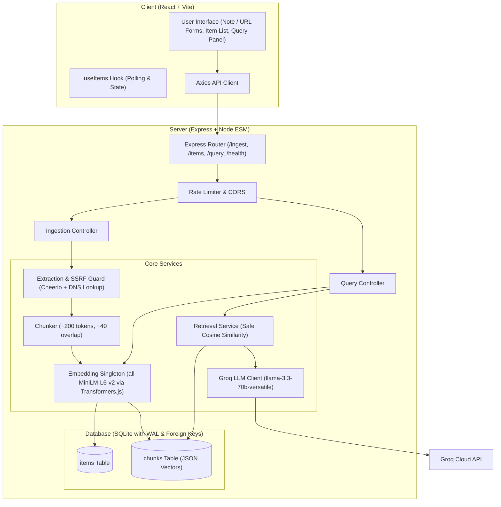
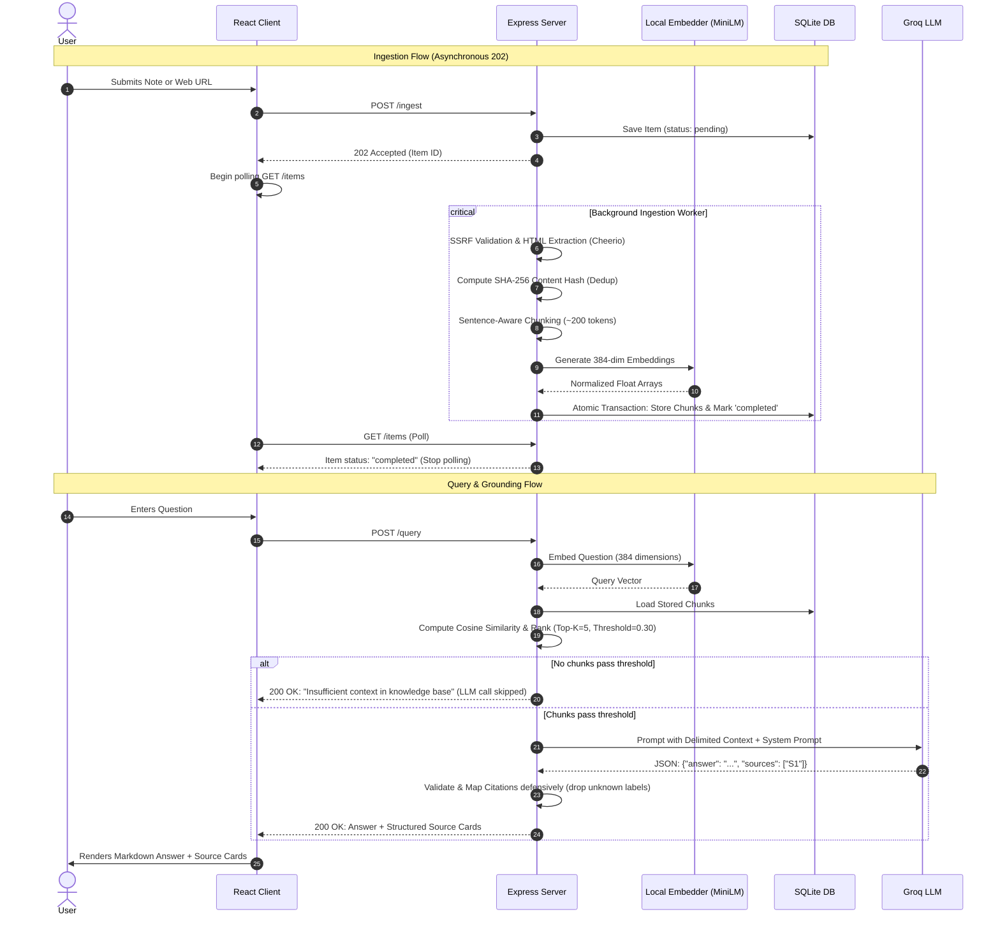

# AI Knowledge Inbox

> A production-style, single-user Retrieval-Augmented Generation (RAG) web application with local embeddings, defensive citation grounding, and async ingestion.

[](server/tests)
[](https://nodejs.org/)
[](LICENSE)

---

## Architecture Overview



---

## End-to-End RAG Sequence



---

## Key Features

1. **Async Ingestion with Real-Time Polling**:
   - `POST /ingest` responds with `202 Accepted` immediately. Background worker performs fetching, sanitization, chunking, and embedding.
   - Client polls `GET /items` automatically while items are in `pending` or `processing` states, stopping automatically when all items are terminal.
   - Server startup recovery resets stuck `processing` items to `failed` with descriptive error messages.
2. **Deterministic, Sentence-Aware Chunking**:
   - Sized to ~200 tokens with ~40 token overlap using a calibrated `words * 1.3` token heuristic.
   - Respects MiniLM's 256-token hard cut-off to prevent silent truncation.
3. **Local Embedding Singleton**:
   - Runs `all-MiniLM-L6-v2` locally via `@huggingface/transformers` using the native ONNX runtime.
   - Yields 384-dimensional L2-normalized float arrays with zero external API fees or network latency.
4. **Hardened SSRF Protection for Web Ingestion**:
   - Only `http:` and `https:` schemes allowed.
   - DNS resolution filters out loopback (`127.0.0.0/8`, `::1`), private networks (`10.0.0.0/8`, `172.16.0.0/12`, `192.168.0.0/16`), link-local/cloud metadata (`169.254.169.254`), and CGNAT ranges.
   - Re-checks DNS resolution on every redirect jump (max 5 redirects).
   - 10-second request timeout and 5MB streaming size cap.
5. **Prompt Injection Defense & Defensive Citation Mapping**:
   - Delimits context within explicit `<<<CONTEXT_SOURCE label="S1">>>` boundaries.
   - Strict system prompt instructs the model to disregard instructions contained within context data.
   - Groq output is parsed defensively: any citation label not in the retrieved set (e.g. `S99`) is safely discarded.
6. **Optimized SQLite Storage**:
   - Write-Ahead Logging (`WAL` mode) ensures non-blocking concurrent reads during ingestion writes.
   - Foreign key cascading ensures that deleting an item deletes all associated vector chunks atomically.

---

## Database Schema

```sql
-- Items Table
CREATE TABLE items (
  id TEXT PRIMARY KEY,
  title TEXT,
  content TEXT,
  content_hash TEXT,
  source_type TEXT CHECK(source_type IN ('note', 'url')) NOT NULL,
  source_url TEXT,
  processing_status TEXT CHECK(processing_status IN ('pending', 'processing', 'completed', 'failed')) NOT NULL DEFAULT 'pending',
  error_message TEXT,
  created_at TEXT NOT NULL,
  updated_at TEXT NOT NULL
);

-- Chunks Table
CREATE TABLE chunks (
  id TEXT PRIMARY KEY,
  item_id TEXT NOT NULL,
  chunk_index INTEGER NOT NULL,
  chunk_text TEXT NOT NULL,
  embedding TEXT NOT NULL, -- JSON-serialized float array (384 dimensions)
  created_at TEXT NOT NULL,
  FOREIGN KEY (item_id) REFERENCES items(id) ON DELETE CASCADE
);

-- Indexes
CREATE INDEX idx_chunks_item_id ON chunks(item_id);
CREATE INDEX idx_items_content_hash ON items(content_hash);
```

---

## Environment Variables

| Variable | Type | Default | Description |
| :--- | :--- | :--- | :--- |
| `PORT` | Number | `3001` | HTTP server port |
| `NODE_ENV` | String | `development` | Environment (`development`, `production`, `test`) |
| `CLIENT_ORIGIN` | String | `http://localhost:5173` | Allowed CORS origin |
| `DATABASE_PATH` | String | `./data/knowledge.db` | Path to SQLite database file |
| `GROQ_API_KEY` | String | *Required* | Groq API Key (validated on startup) |
| `GROQ_MODEL` | String | `llama-3.3-70b-versatile` | Groq chat model identifier |
| `CHUNK_SIZE` | Number | `200` | Target tokens per chunk |
| `CHUNK_OVERLAP` | Number | `40` | Overlap tokens between adjacent chunks |
| `TOP_K` | Number | `5` | Maximum number of chunks retrieved |
| `SIMILARITY_THRESHOLD` | Number | `0.30` | Minimum cosine similarity score threshold |
| `RATE_LIMIT_WINDOW_MS` | Number | `60000` | Rate limiter window in milliseconds (1 min) |
| `RATE_LIMIT_MAX_REQUESTS` | Number | `60` | Maximum requests per IP per window |

---

## Getting Started

### Prerequisites
- Node.js `v20.0.0+` (tested on `v24.19.0`)
- npm `v10+`
- A valid Groq API Key ([https://console.groq.com/keys](https://console.groq.com/keys))

### Installation
1. Clone the repository and enter the directory:
   ```bash
   cd ai-knowledge-inbox
   ```
2. Install dependencies:
   ```bash
   npm install --prefix server
   npm install --prefix client
   ```
3. Set up environment variables:
   ```bash
   cp .env.example server/.env
   ```
   Open `server/.env` and insert your `GROQ_API_KEY`:
   ```ini
   GROQ_API_KEY=gsk_your_actual_groq_key_here
   ```

### Running the Application
To run the full stack in development mode:

**Terminal 1 (Backend Server):**
```bash
npm run server:dev
# Server starts on http://localhost:3001
```

**Terminal 2 (Frontend Client):**
```bash
npm run client
# Client starts on http://localhost:5173
```

### Seeding Demo Data
To populate the knowledge base with realistic technical notes through the real embedding pipeline:
```bash
npm run seed
```

---

## API Documentation & Examples (curl)

### 1. Ingest a Plain Text Note
```bash
curl -X POST http://localhost:3001/ingest \
  -H "Content-Type: application/json" \
  -d '{
    "source_type": "note",
    "title": "SQLite WAL Mode",
    "content": "SQLite supports Write-Ahead Logging (WAL) mode to drastically improve concurrency..."
  }'
```
**Response (`202 Accepted`):**
```json
{
  "success": true,
  "data": {
    "id": "7d6377d9-9ba8-4b8a-8f3e-1ce3327c0a8f",
    "title": "SQLite WAL Mode",
    "source_type": "note",
    "processing_status": "pending",
    "created_at": "2026-11-18T19:44:15.123Z"
  }
}
```

### 2. Ingest a Web URL (with SSRF protection)
```bash
curl -X POST http://localhost:3001/ingest \
  -H "Content-Type: application/json" \
  -d '{
    "source_type": "url",
    "url": "https://example.com/article",
    "title": "Example Article"
  }'
```

### 3. List Knowledge Items
```bash
curl -X GET "http://localhost:3001/items?limit=10&offset=0"
```
**Response (`200 OK`):**
```json
{
  "success": true,
  "data": [
    {
      "id": "7d6377d9-9ba8-4b8a-8f3e-1ce3327c0a8f",
      "title": "SQLite WAL Mode",
      "preview": "SQLite supports Write-Ahead Logging (WAL) mode to drastically improve concurrency...",
      "source_type": "note",
      "processing_status": "completed",
      "chunk_count": 1,
      "created_at": "2026-11-18T19:44:15.123Z"
    }
  ],
  "meta": {
    "limit": 10,
    "offset": 0,
    "count": 1,
    "hasMore": false
  }
}
```

### 4. Query the Knowledge Base (RAG)
```bash
curl -X POST http://localhost:3001/query \
  -H "Content-Type: application/json" \
  -d '{
    "question": "How does SQLite WAL mode improve concurrency?"
  }'
```
**Response (`200 OK`):**
```json
{
  "success": true,
  "data": {
    "answer": "SQLite WAL mode improves concurrency by writing changes to a separate `-wal` file instead of directly locking the main database file. This allows readers to continue reading from the main database concurrently without waiting on writers.",
    "sources": [
      {
        "id": "7d6377d9-9ba8-4b8a-8f3e-1ce3327c0a8f",
        "title": "SQLite WAL Mode",
        "label": "S1",
        "similarity": 0.8241,
        "snippet": "With WAL mode enabled via PRAGMA journal_mode = WAL, readers read from the main database file while writers append changes to a separate -wal file..."
      }
    ]
  }
}
```

---

## Running the Automated Test Suite

The test suite is powered by **Vitest** and **Supertest**, featuring unit and integration tests across all layers.

To run all tests:
```bash
cd server
npm test
```

### Test Coverage Highlights
- **Chunking**: Sentence boundary detection, token budgeting, overlap verification, empty/whitespace edge cases.
- **SSRF & URL Extraction**: Private IP filtering (IPv4/IPv6/metadata), protocol restrictions, Cheerio HTML stripping.
- **Embeddings**: Real 384-dimensional vector validation with `all-MiniLM-L6-v2`, L2 normalization check, safe cosine calculations (guards against division-by-zero and dimension mismatch).
- **Ingestion Pipeline**: Asynchronous status transitions, deduplication through content hashing, failure recovery.
- **Retrieval & Citations**: Threshold filtering, ranking, short-circuiting on insufficient context without calling Groq, defensive dropped citation labels, 502 upstream failure handling.
- **HTTP Endpoints**: Validation envelopes, status codes (`200`, `202`, `400`, `422`, `502`).

---

## Limitations & Future Work

- **Full Vector Scans**: SQLite JSON vectors are evaluated via in-memory brute force scan. For collections larger than 50,000 chunks, migrate to PostgreSQL with `pgvector` or a dedicated vector engine (Qdrant).
- **In-Process Queue**: Background ingestion uses `setImmediate`. In a multi-instance production environment, replace with a persistent queue (e.g. BullMQ on Redis).
- **Single-User Scope**: Currently has no authentication or tenant separation. Production evolution requires JWT-based auth and tenant-keyed database isolation.
