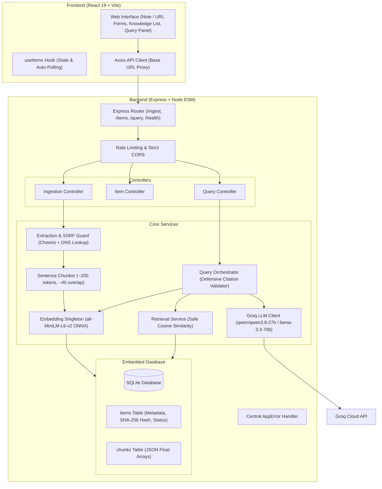
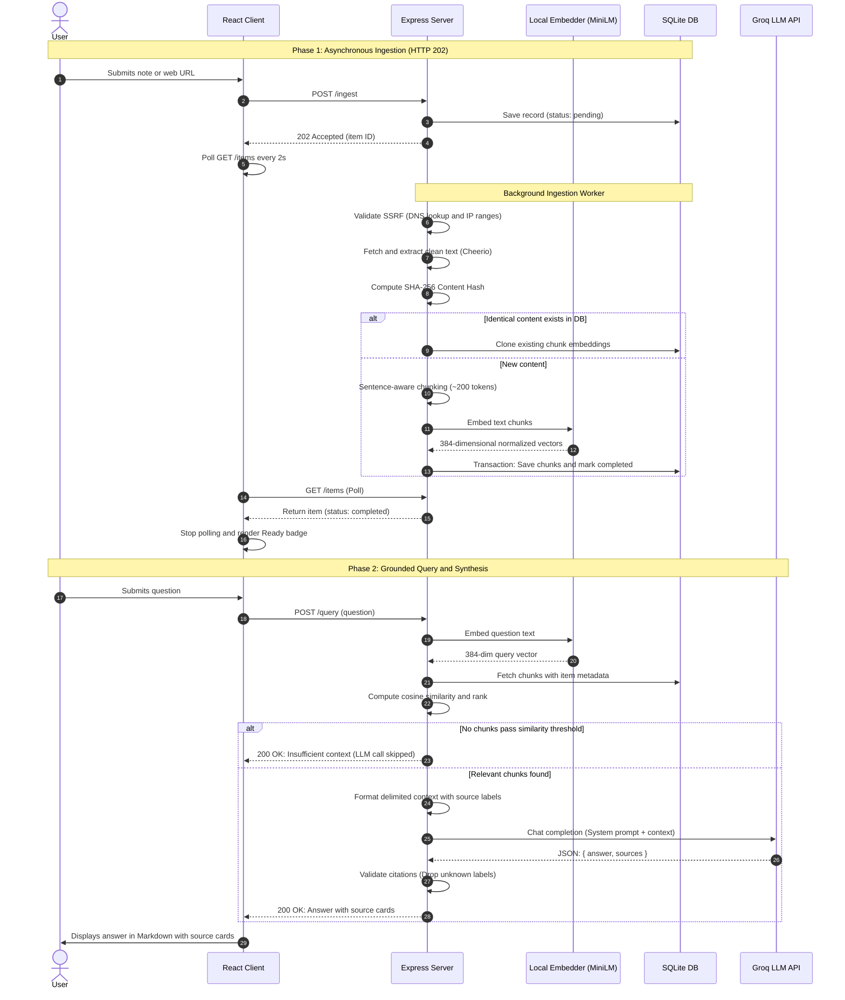

# AI Knowledge Inbox

> A production-style, single-user Retrieval-Augmented Generation (RAG) web application with local embeddings, defensive citation grounding, and asynchronous ingestion.

[](https://nodejs.org/)
[](server/tests)
[](https://www.sqlite.org/)
[](https://groq.com/)
[](LICENSE)

---

## Table of Contents
- [Overview](#overview)
- [Architecture Diagram](#architecture-diagram)
- [End-to-End RAG Sequence](#end-to-end-rag-sequence)
- [Key Features](#key-features)
- [Technology Stack](#technology-stack)
- [Database Schema](#database-schema)
- [Configuration & Environment Variables](#configuration--environment-variables)
- [Getting Started](#getting-started)
- [API Reference (with cURL examples)](#api-reference)
- [Automated Testing](#automated-testing)
- [Production Tradeoffs & Evolution](#production-tradeoffs--evolution)

---

## Overview

**AI Knowledge Inbox** allows a user to save notes and web pages into a searchable repository, automatically generating semantic embeddings and performing grounded, cited question answering using a Large Language Model.

The application follows production-grade backend design patterns:
- **Async Ingestion**: Non-blocking `202 Accepted` response pattern with automated background workers and client-side status polling.
- **SSRF Hardening**: Multi-layer URL validation with DNS resolution checks rejecting loopback, link-local, cloud metadata, and private IP ranges across all redirects.
- **Deterministic Chunking**: Sentence-boundary-aware chunker calibrated for MiniLM's 256-token truncation threshold.
- **Local Embeddings**: In-memory singleton ONNX inference via `@huggingface/transformers` (`all-MiniLM-L6-v2`) producing normalized 384-dimensional dense vectors with zero external API latency or costs.
- **Prompt Injection Defense & Citation Mapping**: Strict context delimiting, untrusted-data instructions, and defensive citation validation that drops fabricated labels before returning responses.

---

## Architecture Diagram



---

## End-to-End RAG Sequence



---

## Key Features

1. **Robust Async Ingestion Pipeline**:
   - `POST /ingest` returns immediately with `202 Accepted`.
   - Dedicated in-process worker handles fetching, extraction, chunking, and embedding.
   - Client polls `GET /items` every 2 seconds while items are `pending` or `processing`, stopping automatically when terminal.
   - Server startup recovery: any item interrupted in `processing` state during a server restart is automatically flagged as `failed` with a descriptive message.

2. **Hardened SSRF Protection**:
   - Strictly enforces `http:` and `https:` schemes.
   - Performs asynchronous DNS resolution using `dns.promises.lookup` to filter out private ranges (`10.0.0.0/8`, `172.16.0.0/12`, `192.168.0.0/16`), loopback (`127.0.0.0/8`, `::1`), link-local/cloud metadata (`169.254.169.254`), and CGNAT (`100.64.0.0/10`).
   - Re-checks DNS on every redirect jump (capped at 5 redirects).
   - Enforces a 10-second timeout and 5MB streaming response cap.

3. **Deterministic, Sentence-Aware Chunking**:
   - Sized to ~200 tokens with ~40 token overlap using a calibrated `words * 1.3` token heuristic.
   - Respects MiniLM's 256-token hard cut-off to prevent silent truncation.

4. **Local Embedding Singleton**:
   - Runs `all-MiniLM-L6-v2` locally via `@huggingface/transformers` using the native ONNX runtime.
   - Yields 384-dimensional L2-normalized float arrays with zero external API fees or network latency.

5. **Defensive Prompt Injection & Citation Verification**:
   - Wraps context inside `<<<CONTEXT_SOURCE label="S1">>>` tags.
   - Instructs the LLM that context is untrusted reference data.
   - Rejects hallucinated citations: any label returned by the LLM that was not in the retrieved set (e.g., `S99`) is safely dropped.

6. **SQLite Storage with WAL Mode**:
   - `PRAGMA journal_mode = WAL` allows readers to access the database concurrently with background ingestion writes without blocking.
   - `PRAGMA foreign_keys = ON` ensures cascading deletion of vector chunks when an item is deleted.

---

## Technology Stack

| Layer | Technologies |
| :--- | :--- |
| **Backend Runtime** | Node.js (ESM), Express |
| **Database** | SQLite via `better-sqlite3` (WAL mode enabled) |
| **Embeddings** | `@huggingface/transformers` (`all-MiniLM-L6-v2`, 384-dim ONNX) |
| **LLM Provider** | Groq Cloud SDK (`groq-sdk`) |
| **Validation & Security** | Zod (startup config & request schemas), `express-rate-limit`, CORS |
| **Logging** | Pino + `pino-http`, `pino-pretty` (with secret redaction) |
| **HTML Extraction** | Cheerio |
| **Frontend** | React 19, Vite, Axios, `react-markdown`, `lucide-react` |
| **Testing** | Vitest, Supertest (52 automated tests) |

---

## Database Schema

```sql
-- Items Table
CREATE TABLE items (
  id TEXT PRIMARY KEY,
  title TEXT,
  content TEXT,
  content_hash TEXT,
  source_type TEXT CHECK(source_type IN ('note', 'url')) NOT NULL,
  source_url TEXT,
  processing_status TEXT CHECK(processing_status IN ('pending', 'processing', 'completed', 'failed')) NOT NULL DEFAULT 'pending',
  error_message TEXT,
  created_at TEXT NOT NULL,
  updated_at TEXT NOT NULL
);

-- Chunks Table
CREATE TABLE chunks (
  id TEXT PRIMARY KEY,
  item_id TEXT NOT NULL,
  chunk_index INTEGER NOT NULL,
  chunk_text TEXT NOT NULL,
  embedding TEXT NOT NULL, -- JSON-serialized float array (384 dimensions)
  created_at TEXT NOT NULL,
  FOREIGN KEY (item_id) REFERENCES items(id) ON DELETE CASCADE
);

-- Indexes
CREATE INDEX idx_chunks_item_id ON chunks(item_id);
CREATE INDEX idx_items_content_hash ON items(content_hash);
```

---

## Configuration & Environment Variables

Create a `.env` file in `server/` (or the repository root) based on `.env.example`:

| Variable | Type | Default | Description |
| :--- | :--- | :--- | :--- |
| `PORT` | Number | `3001` | HTTP server port |
| `NODE_ENV` | String | `development` | Environment mode (`development`, `production`, `test`) |
| `CLIENT_ORIGIN` | String | `http://localhost:5173` | Allowed CORS origin |
| `DATABASE_PATH` | String | `./data/knowledge.db` | Relative or absolute path to SQLite file |
| `GROQ_API_KEY` | String | *Required* | Groq API Key (validated on startup) |
| `GROQ_MODEL` | String | `qwen/qwen3.8-27b` | Model ID (e.g. `qwen/qwen3.8-27b`, `llama-3.3-70b-versatile`) |
| `CHUNK_SIZE` | Number | `200` | Target token budget per chunk |
| `CHUNK_OVERLAP` | Number | `40` | Overlap tokens between adjacent chunks |
| `TOP_K` | Number | `5` | Maximum number of chunks retrieved |
| `SIMILARITY_THRESHOLD` | Number | `0.25` | Minimum cosine similarity score threshold |
| `RATE_LIMIT_WINDOW_MS` | Number | `60000` | Rate limiter window in milliseconds (1 min) |
| `RATE_LIMIT_MAX_REQUESTS` | Number | `60` | Maximum requests per IP per window |

---

## Getting Started

### Prerequisites
- Node.js `v20.0.0+` (tested and verified on `v24.19.0`)
- npm `v10+`
- A valid Groq API Key ([https://console.groq.com/keys](https://console.groq.com/keys))

### Installation
1. Clone the repository and enter the directory:
   ```bash
   git clone https://github.com/BhaskaraRao-Aerupilli/ai-knowledge-inbox.git
   cd ai-knowledge-inbox
   ```
2. Install dependencies:
   ```bash
   npm install --prefix server
   npm install --prefix client
   ```
3. Configure environment variables:
   ```bash
   cp .env.example server/.env
   ```
   Add your `GROQ_API_KEY` in `server/.env`:
   ```ini
   GROQ_API_KEY=gsk_your_groq_api_key_here
   GROQ_MODEL=qwen/qwen3.8-27b
   SIMILARITY_THRESHOLD=0.25
   ```

### Running the Application
Run the backend and frontend in separate terminals:

**Terminal 1 (Backend Server):**
```bash
npm run server:dev
# Server starts on http://localhost:3001
```

**Terminal 2 (Frontend Client):**
```bash
npm run client
# Client starts on http://localhost:5173
```

### Seeding Demo Data
To populate the knowledge base with real technical notes using the real embedding pipeline:
```bash
npm run seed
```

---

## API Reference

All responses follow a consistent envelope: `{ success: true, data: ... }` or `{ success: false, error: { code, message } }`.

### 1. Ingest a Plain Text Note
- **Endpoint**: `POST /ingest`
- **Request**:
  ```bash
  curl -X POST http://localhost:3001/ingest \
    -H "Content-Type: application/json" \
    -d '{
      "source_type": "note",
      "title": "SQLite WAL Mode",
      "content": "SQLite supports Write-Ahead Logging (WAL) to enable concurrent reads and writes..."
    }'
  ```
- **Response (`202 Accepted`)**:
  ```json
  {
    "success": true,
    "data": {
      "id": "ebd9fc4b-ed2a-4cde-89e3-f09a2c668440",
      "title": "SQLite WAL Mode",
      "source_type": "note",
      "processing_status": "pending",
      "created_at": "2026-11-18T14:20:36.833Z"
    }
  }
  ```

### 2. Ingest a Web URL
- **Endpoint**: `POST /ingest`
- **Request**:
  ```bash
  curl -X POST http://localhost:3001/ingest \
    -H "Content-Type: application/json" \
    -d '{
      "source_type": "url",
      "url": "https://en.wikipedia.org/wiki/Cosine_similarity",
      "title": "Wikipedia: Cosine Similarity"
    }'
  ```

### 3. List Knowledge Items
- **Endpoint**: `GET /items?limit=10&offset=0`
- **Response (`200 OK`)**:
  ```json
  {
    "success": true,
    "data": [
      {
        "id": "ebd9fc4b-ed2a-4cde-89e3-f09a2c668440",
        "title": "SQLite WAL Mode",
        "preview": "SQLite supports Write-Ahead Logging (WAL) to enable concurrent reads and writes...",
        "source_type": "note",
        "processing_status": "completed",
        "chunk_count": 1,
        "created_at": "2026-11-18T14:20:36.833Z"
      }
    ],
    "meta": {
      "limit": 10,
      "offset": 0,
      "count": 1,
      "hasMore": false
    }
  }
  ```

### 4. Query the Knowledge Base (RAG)
- **Endpoint**: `POST /query`
- **Request**:
  ```bash
  curl -X POST http://localhost:3001/query \
    -H "Content-Type: application/json" \
    -d '{
      "question": "How does SQLite WAL mode improve concurrency?"
    }'
  ```
- **Response (`200 OK`)**:
  ```json
  {
    "success": true,
    "data": {
      "answer": "SQLite WAL mode improves concurrency by allowing readers to read from the main database file while writers append changes to a separate -wal file, preventing writers from blocking readers.",
      "sources": [
        {
          "id": "ebd9fc4b-ed2a-4cde-89e3-f09a2c668440",
          "title": "SQLite WAL Mode and Concurrency",
          "label": "S1",
          "similarity": 0.6945,
          "snippet": "SQLite supports Write-Ahead Logging (WAL) to enable concurrent reads and writes. Under traditional rollback journal mode, writing locks the entire database file against concurrent readers..."
        }
      ]
    }
  }
  ```

### 5. Health Check
- **Endpoint**: `GET /health`
- **Response (`200 OK`)**:
  ```json
  {
    "success": true,
    "data": {
      "status": "healthy",
      "timestamp": "2026-11-18T14:30:00.000Z",
      "models": {
        "llm": "qwen/qwen3.8-27b",
        "embeddings": "Xenova/all-MiniLM-L6-v2"
      }
    }
  }
  ```

---

## Automated Testing

The automated test suite runs via **Vitest** and **Supertest**:

```bash
cd server
npm test
```

### Verified Test Suites (52 Tests Passing)
- **`tests/chunking.test.js`**: Sentence boundary splitting, token budget enforcement, chunk overlap verification, empty input handling.
- **`tests/db.test.js`**: Schema initialization, WAL pragma, cascading chunk deletion on item delete, stuck item recovery on startup.
- **`tests/embedding.test.js`**: Cosine similarity math, non-finite guard rails, malformed vector parsing, and real 384-dimensional embedding validation.
- **`tests/extraction.test.js`**: SSRF private IP validation, loopback blocking, HTML boilerplate stripping via Cheerio, and SHA-256 deduplication hashing.
- **`tests/ingestion.test.js`**: Asynchronous status transitions, deduplication chunk reuse, and graceful failure handling.
- **`tests/query.test.js`**: Similarity ranking, threshold filtering, short-circuiting on low context, and defensive citation mapping.
- **`tests/api.test.js`**: HTTP status codes (`200`, `202`, `400`, `404`, `502`), error envelopes, and input validation.

---

## Production Tradeoffs & Evolution

For a detailed analysis of architectural choices, scalability limits, and production evolution, see [**`DECISIONS.md`**](./DECISIONS.md).

- **Current Architecture**: SQLite + JSON float vectors + brute-force cosine search. Optimal for single-user workspaces up to ~50,000 chunks with zero infrastructure overhead.
- **Production Evolution**:
  1. **PostgreSQL + pgvector**: Replace SQLite JSON vectors with HNSW indexes for $O(\log N)$ approximate nearest neighbor search.
  2. **Distributed Queue (BullMQ / Redis)**: Decouple background ingestion from the web process for horizontal worker scaling and retry backoff.
  3. **Multi-Tenancy & Auth**: Add JWT-based authentication with row-level security (RLS) for tenant document isolation.
  4. **Semantic Caching**: Add Redis caching for repeated questions and embedding vectors.
